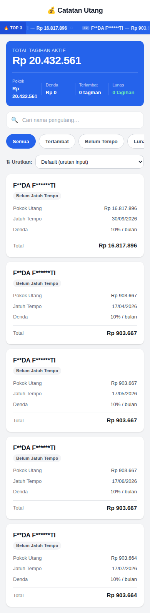

# Catatan Utang

Aplikasi web sederhana untuk memantau utang aktif. Dibangun dengan **React** dan
**Vite**, tanpa backend.



## Fitur

- Ringkasan total pokok, denda, dan jumlah tagihan terlambat
- Pencarian berdasarkan nama pengutang
- Pengurutan berdasarkan status, jatuh tempo, dan total tagihan
- Perhitungan denda bulanan otomatis
- Tampilan responsif untuk perangkat mobile

## Menjalankan secara lokal

```bash
npm install
npm run dev
```

Perintah lain yang tersedia:

```bash
npm run lint    # Periksa kualitas kode
npm run build   # Buat build production
npm run preview # Jalankan preview dari hasil build
```

## Mengubah data

Data produksi dikelola di branch `data`, pada file `debts.json` di root branch
tersebut. Setiap item menggunakan format berikut:

```json
{
  "id": "1",
  "nama": "Nama Pengutang",
  "jumlah": 1000000,
  "tempo": "30/09/2026",
  "denda": 10,
  "lunas": false
}
```

`jumlah` adalah angka dalam rupiah tanpa pemisah. `tempo` menggunakan format
`DD/MM/YYYY`, sedangkan `denda` adalah persentase per bulan.

Untuk pengembangan lokal, aplikasi membaca `src/data/debts.json`.

## Deployment

Workflow `.github/workflows/deploy.yml` berjalan setiap ada push ke branch `main`.
Sebelum build, workflow mengambil `debts.json` terbaru dari branch `data` dan
menyalinnya ke `src/data/debts.json`, lalu menerbitkan hasil build ke GitHub Pages.

Perubahan pada branch `data` saja tidak memicu deployment. Setelah memperbarui data,
jalankan deployment melalui push ke `main`.

## Struktur utama

```text
src/
├── App.jsx
├── components/     # Komponen antarmuka
├── data/           # Loader dan data utang lokal
└── utils/          # Format rupiah, tanggal, status, dan denda
```
